# Sala Company — Start Page

**Live: [go.sala.company](https://go.sala.company)**

The start page for all of Sala Company's browser projects: live world news, market heatmaps, games and AI tools. Everything is free and runs in the browser, with no install and, except for Scene to Story's AI, no sign-up. Almost all of it was vibe coded from the start: built by describing it to an AI and refining it together, rather than written line by line.

[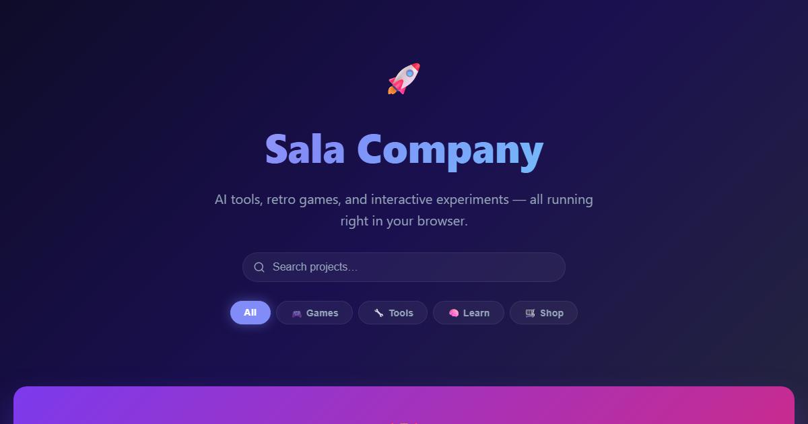](https://go.sala.company)

## What's new — October 2026

Keep this list to the last month or so. On the page, the **Just added** row and the **New** badges come from each card's `data-added` date on their own, so there is nothing to update there by hand.

- **Flattery:** an app store of free clones of the apps you pay for (reverse-engineered, reimagined, white-room and vibe-coded copies), found on X and Hacker News every 8 hours and rated by the crowd: ❤️ Loved, ⭐ Proven on GitHub, 🔥 Hyped, 😐 Mixed, 🆕 New and ☠️ Don't touch. Each app shows what it clones, how it compares with the original, whether you can install it, and a weekly newsletter; anyone can suggest or object to a listing on X.
- **Sand Digger:** a desert take on the arcade digging classic. A Bedouin kid tunnels through realistic sand layers, slings pebbles at uromastyx lizards (three hits knock one out), dodges cobras that spit venom through the sand, and drops clay pots on them; a golden dallah bonus, the last enemy running for the exit, an original Hijaz-scale tune, and keyboard and touch controls.
- **Yeti:** an arcade climbing game: a penguin climbs icy ledges to rescue a chick from a snowball-throwing yeti. Four stages (sloped ice ledges with rolling snowballs, a frozen fish factory with conveyor belts, ski lifts with bouncing iceballs, and an ice-bolt peak you bring down by pulling 8 bolts), angry seals, a snow shovel power-up, shaded hi-res art, and keyboard, gamepad and touch controls.
- **Heli Attack:** a modern take on the 1981 arcade cave shooters. Six stages with hand-designed set pieces, a gunship boss, checkpoints, power-ups (spread shot, triple bombs, shield), chiptune music, and keyboard, gamepad and touch controls; installable as an app.
- **Last Marine Standing:** a classic 90s first-person shooter in the browser. The Chocolate Doom engine compiled to WebAssembly, playing Freedoom's 4 episodes and 36 levels with full sound and music, with saved games kept in your browser.
- **radio.sala.company:** free internet radio in a 10-band shortwave portable. Stations from Radio Browser, SomaFM and community M3U lists, search across all of them, an in-browser check of which stations are on air, the song or show that's playing, automatic reconnecting, and favorites and the songs you heard kept in your browser.
- **video.sala.company:** free live TV in a 70s wood-panel TV with an 80s cable guide. About 11,000 public channels from iptv-org or your own M3U playlist, signal bars that warn about slow or dead channels before you click, automatic backup sources, and favorites, ratings and recently watched kept in your browser.
- **Artograph:** a Spirograph in the browser. One-tap recipes, rings and wheels with real tooth counts, a pattern preview on every wheel, numbered pen holes, gel-pen colors, drag-to-crank drawing, rosettes, layers you can hide or recolor, gear clicks, PNG and SVG export and share links.
- **Scene to Story:** record, upload or pick a YouTube clip up to a minute long, and the AI (Claude) writes the moment as prose, a poem or a screenplay. The video stays on your device, and the AI is paid for through your own OpenRouter account.
- **Heat ETFs:** 112 of the most traded US stock ETFs, grouped into the US market, the 11 sectors, industries and themes, and countries.
- **Sala News** is out of beta: a new look, about 95 live sources, breaking-news alerts and videos from 29 news channels.
- **Heat Rates:** official government bond yield curves for 14 markets, with real yields and ten years of history.
- **Rizq:** traders and banking, a pickup truck home for your herd, smarter animals and a daily run.
- **New start page design:** projects grouped by what they are, a screenshot on every card, light and dark themes, and the most active projects first.

## Projects

In the order the page shows them, most active first.

### 🔴 Live data

| | Project | What it is | Code |
|---|---|---|---|
| 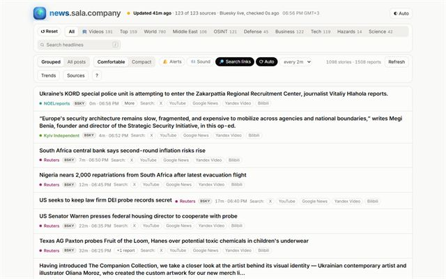 | **[Sala News — The World Now](https://news.sala.company)** | Live world headlines from about 95 news, OSINT and disaster sources, refreshed every few minutes, with breaking-news alerts, videos from 29 news channels and search links under every headline. | [the-world-now](https://github.com/jamalxcode/the-world-now) |
| 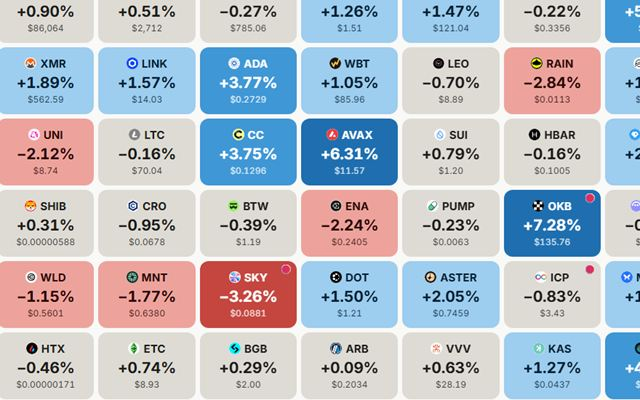 | **[Heat — Market Heatmaps](https://heat.sala.company)** <br>[Forex](https://heat.sala.company/forex/) · [Metals](https://heat.sala.company/metals/) · [Energy](https://heat.sala.company/energy/) · [ETFs](https://heat.sala.company/etfs/) · [Rates](https://heat.sala.company/rates/) | The top 100 coins with RSI, trend, point & figure, momentum and suggested stop-losses on every tile, and a daily scorecard that checks the signals against what happened next. Also 48 currencies (ECB rates), precious metals, oil and gas, 112 US stock ETFs by sector, theme and country, and official bond yield curves for 14 markets. Refreshes every 10 minutes. *Beta, not financial advice.* | [heat](https://github.com/jamalxcode/heat) |
| 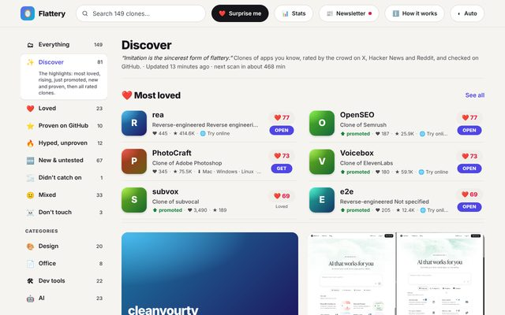 | **[Flattery — Clones, Rated](https://flattery.sala.company)** <br>[Free alternatives](https://flattery.sala.company/alternatives/) · [Stats](https://flattery.sala.company/stats/) | An app store of free clones, reverse-engineered and reimagined versions of popular apps, found on X and Hacker News and rated by how people reacted, with GitHub stars and downloads as proof. Each app shows what it clones, how it compares with the original and whether you can install it. Updated every 8 hours. *Beta.* | [flattery](https://github.com/jamalxcode/flattery) |

### 🟠 Games

| | Project | What it is | Code |
|---|---|---|---|
| 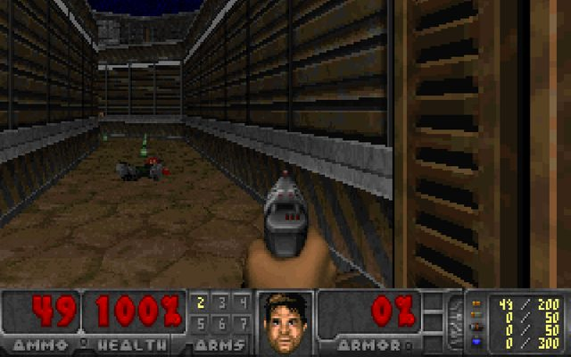 | **[Last Marine Standing](https://last.sala.company)** | A classic 90s first-person shooter: the Chocolate Doom engine compiled to WebAssembly, playing Freedoom's 4 episodes and 36 levels with full sound and music. Click to play, Space or Enter in the menus, and saved games stay in your browser. | [last](https://github.com/jamalxcode/last) |
| 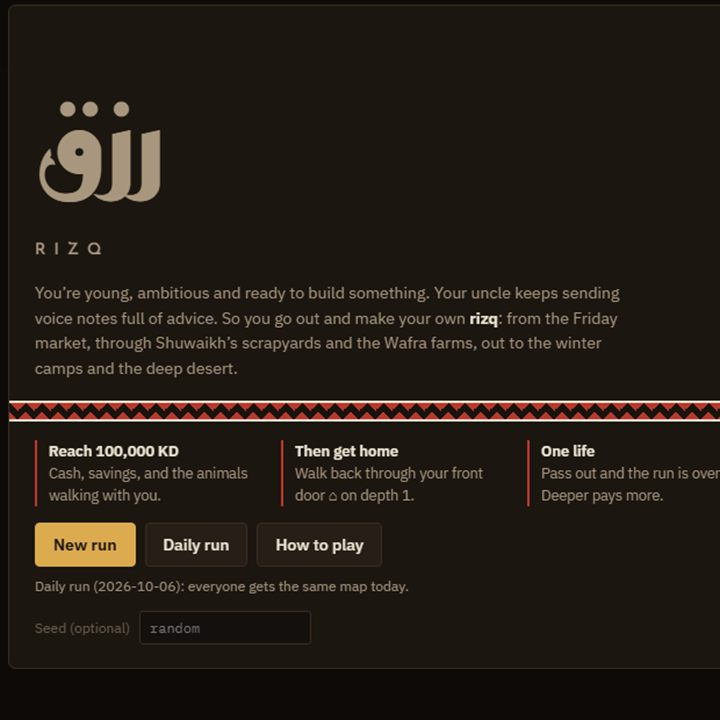 | **[Rizq — A Kuwaiti Roguelike](https://rizq.sala.company)** | A Brogue-inspired roguelike set in modern Kuwait. Build a camel herd with dates, trade and bank at diwaniyas, survive the deep desert, reach 100,000 KD and make it home. One life, plus a daily run on the same map for everyone. | [rizq](https://github.com/jamalxcode/rizq) |
| 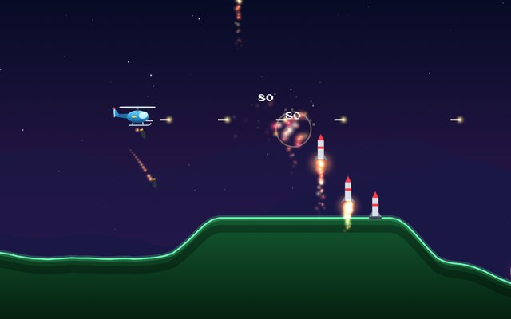 | **[Heli Attack](https://heliattack.sala.company)** | A retro side-scrolling helicopter shooter: six stages with set pieces like missile batteries, laser gates and a meteor shower, fuel you refill by bombing tanks, mid-stage checkpoints, power-ups and a gunship boss guarding the data core. Synthesized chiptune music, keyboard, gamepad and touch controls with auto-fire. | [heli-attack](https://github.com/jamalxcode/heli-attack) |
| 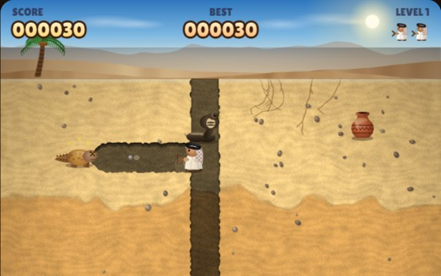 | **[Sand Digger](https://sand.sala.company)** | A desert digging arcade game inspired by Dig Dug: tunnel through four layers of sand as a Bedouin kid, sling pebbles at uromastyx lizards and Arabian cobras (whose venom flies through sand), and drop clay pots on them for big points. Golden dallah bonus, the last enemy runs for the exit, an original Hijaz-scale walking tune, and keyboard and touch controls. | [sand](https://github.com/jamalxcode/sand) |
| 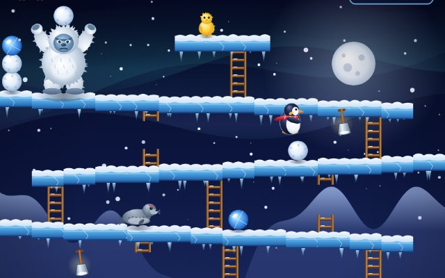 | **[Yeti](https://yeti.sala.company)** | An arcade climbing game: a penguin climbs icy ledges past rolling snowballs and angry seals to rescue a chick from the yeti, then pulls the 8 bolts holding up the peak to bring the yeti down. Snow shovel power-up, bonus timer, shaded hi-res art, and keyboard, gamepad and touch controls. | [yeti](https://github.com/jamalxcode/yeti) |
| 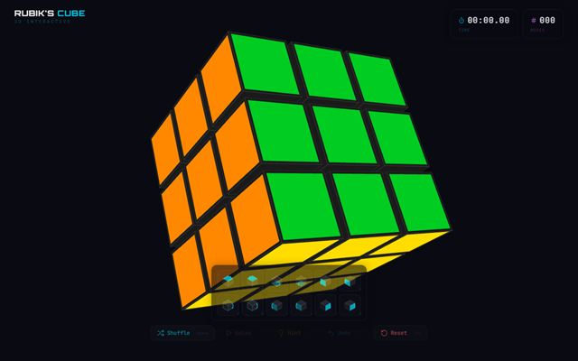 | **[3D Rubik's Cube](https://cube.sala.company)** | Scramble, turn and solve a 3D cube, with hints. React and Three.js. | [cube](https://github.com/jamalxcode/cube) |
| 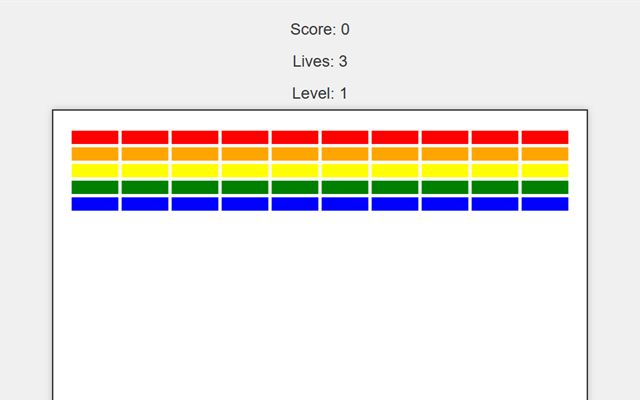 | **[Vibe Coded Breakout](https://breakout.sala.company)** | Version 2.0: 76 levels across 4 worlds, boss fights, and power-ups like Multi-Ball, rockets, lasers and super bombs. The original 2025 version is still playable side by side. | [breakout-game-html](https://github.com/jamalxcode/breakout-game-html) |
| 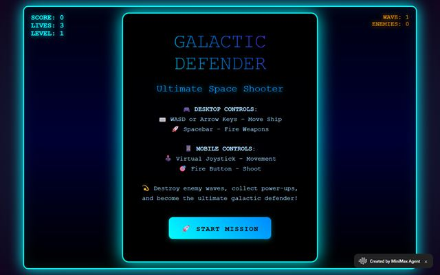 | **[Galactic Defender](https://galacticdefender.sala.company)** | A Galaga-inspired space shooter with keyboard and touch controls. | [galactic_defender](https://github.com/jamalxcode/galactic_defender) |
| 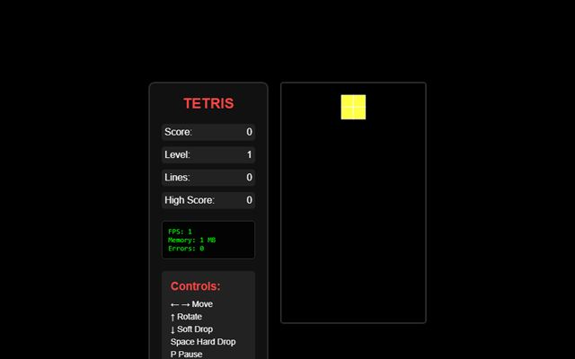 | **[Vibe Coded Tetris](https://tetris.sala.company)** | The classic puzzle game, vibe coded from the start. | [tetris3](https://github.com/jamalxcode/tetris3) |

### 🟣 AI

| | Project | What it is | Code |
|---|---|---|---|
| 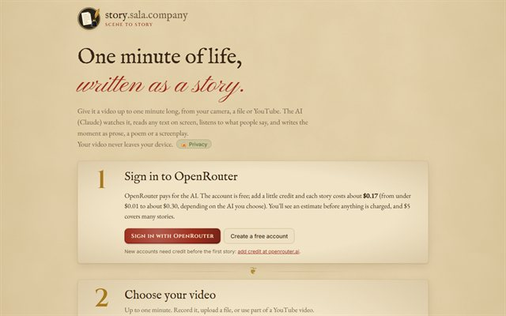 | **[Scene to Story](https://story.sala.company)** | Record, upload or pick a YouTube clip up to a minute long. The AI (Claude) reads the text on screen, listens to what people say and writes the moment as prose, a poem, a screenplay, noir, haiku or a fairy tale, in any language (Arabic included, laid out right to left), on a parchment scroll. The video stays on your device; visitors sign in with their own OpenRouter account to pay for the AI (about $0.17 a story). | [storywriter](https://github.com/jamalxcode/storywriter) |
| 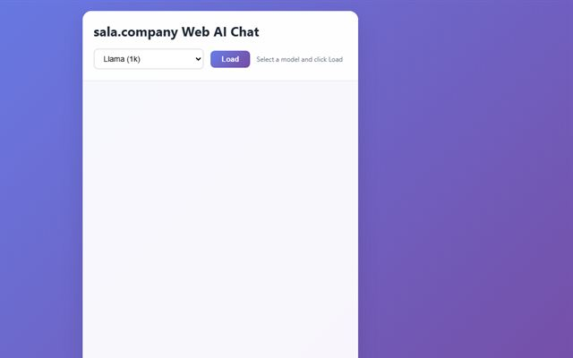 | **[WebAI — Private Browser AI Chat](https://webai.sala.company)** | Chat with open models (Llama, Phi, Mistral, Qwen, Gemma, TinyLlama) running on your own device through WebGPU. Nothing leaves the browser. Needs a WebGPU browser such as recent Chrome or Edge. | [webllm-onefile](https://github.com/jamalxcode/webllm-onefile) |
| 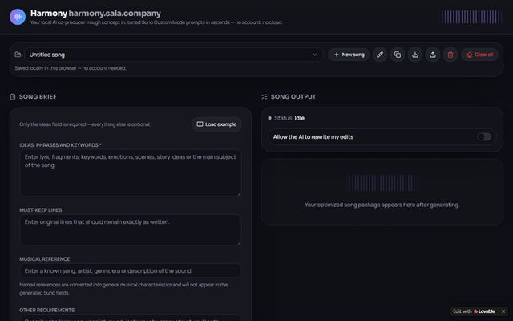 | **[Harmony](https://harmony.sala.company)** | A local AI co-producer for Suno: turns a rough song idea into titles, genre tags, lyric skeletons and exclude lists for Custom Mode. | — |
|  | **[How AI Works](https://understand.sala.company)** | Plain-language explanations of AI, from rule-based systems to neural networks and large language models. Made in [Gamma](https://gamma.app/). | — |
| 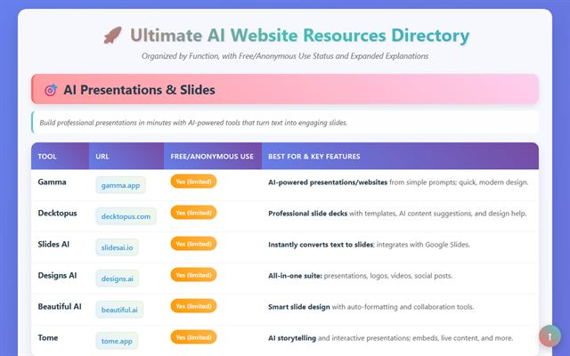 | **[AI Tools Collection](https://ai.sala.company)** | A curated directory of AI websites and tools, grouped by what they do and whether they're free. | [ai-sala-company](https://github.com/jamalxcode/ai-sala-company) |

### 🟢 Watch & listen

| | Project | What it is | Code |
|---|---|---|---|
| 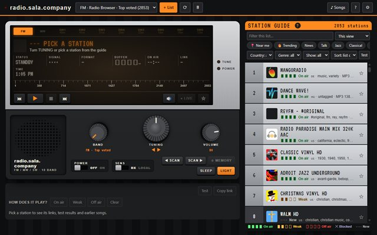 | 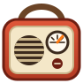 **[radio.sala.company](https://radio.sala.company)** | Free internet radio in a 10-band shortwave portable. Starts with Radio Browser's most-voted stations; search all of Radio Browser (about 50,000 stations), browse Near me, Trending, News, Jazz and other genres, or add SomaFM, junguler's genre M3U lists or your own playlist. Each station is checked in the browser and marked On air, Weak, Off air or Blocked before you click, dropped streams reconnect on their own, and backup links take over when one fails. The dial shows the song or show that's playing (also on the phone lock screen), with a log of songs you heard and links to find them. BAND switches your lists, TUNING moves through stations, plus pause, mute, back-to-live, a sleep timer, favorites and keyboard controls, all kept in your browser. | [radio](https://github.com/jamalxcode/radio) |
| 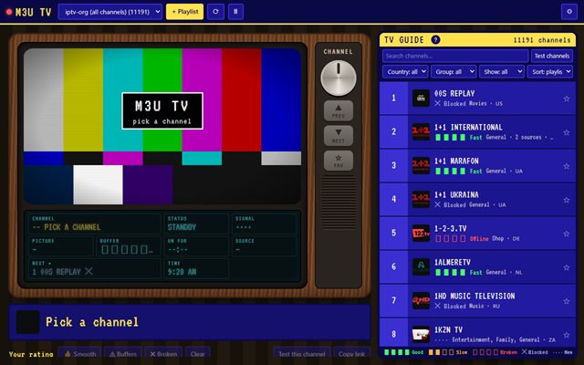 |  **[video.sala.company](https://video.sala.company)** | Free live TV channels in a 70s wood-panel TV next to an 80s cable TV guide. Starts with about 11,000 public channels from iptv-org (filter by country and category, or add a single country's list), or load your own M3U playlist. Signal bars warn which channels are slow, offline or blocked in the browser before you click, GEO and PART-TIME tags flag geo-blocked and part-time channels, and a broken stream switches to a backup source on its own. A VCR-style display shows status, picture quality and how much video is loaded ahead. Channel numbers, a dial, keyboard and TV-remote controls, favorites, ratings and recently watched, all kept in your browser. | [video](https://github.com/jamalxcode/video) |
| 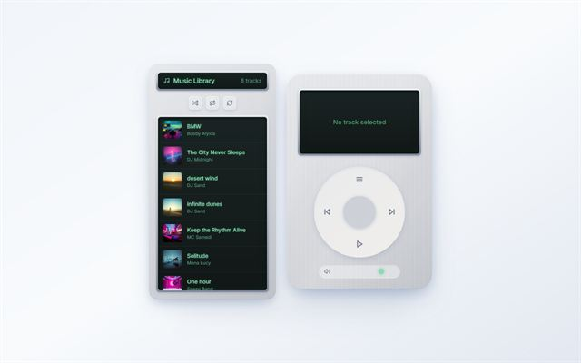 | **[iPod Classic Player](https://music.sala.company)** | A faithful iPod Classic in the browser for your own MP3s. | [retro-tunes-player](https://github.com/jamalxcode/retro-tunes-player) |

### 🩷 Create

| | Project | What it is | Code |
|---|---|---|---|
| 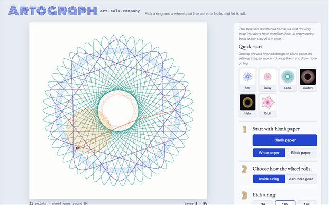 | **[Artograph](https://art.sala.company)** | A Spirograph in the browser. Start from one of six one-tap recipes, or pick a ring and a wheel (real tooth counts, each wheel previewing its pattern), put the pen in one of the wheel's numbered holes and let it roll, or drag around the paper to crank it by hand. Gel-pen colors, white or black paper, rosettes, layers you can hide, recolor or delete, undo and redo, keyboard shortcuts, optional gear clicks and real-toy wobble, PNG (optionally transparent) and SVG export, copy image, and share links that carry the whole drawing. On phones the paper stays on top with the controls in tabs. | [art](https://github.com/jamalxcode/art) |
| 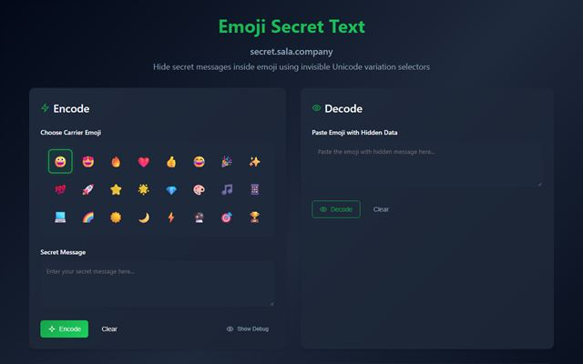 | **[Secret Emoji Messenger](https://secret.sala.company)** | Hide a secret message inside an emoji with invisible Unicode characters. | [hidetext](https://github.com/jamalxcode/hidetext) |

### Newsletter and store

These sit in the footer cards, not in the app grid.

| | Project | What it is | Code |
|---|---|---|---|
| 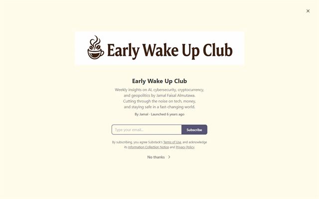 | **[Early Wake Up Club](https://mutawa.substack.com)** | A newsletter on technology, business and AI. Recent: [The Trillion Dollar Club](https://mutawa.substack.com/p/the-trillion-dollar-club) (Jan 2026), [From Mining Bitcoin to Powering ChatGPT](https://mutawa.substack.com/p/from-mining-bitcoin-to-powering-chatgpt) (Dec 2025), [The Great AI Chip War](https://mutawa.substack.com/p/the-great-ai-chip-war-how-china-and) (Nov 2025). | — |
| 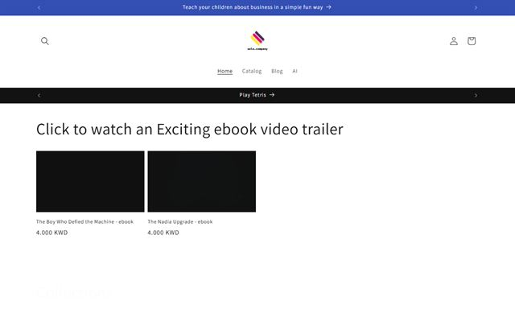 | **[Sala Company Store](https://www.sala.company)** | Ebooks: sci-fi thrillers such as *The Boy Who Defied the Machine*, AI guides, business and children's books. | — |

## How the page works

- **One file, no build step.** Everything is in `index.html`: plain HTML, CSS and JavaScript with no dependencies. GitHub Pages serves it at `go.sala.company` (see `CNAME`), and every push to `main` goes live in about a minute.
- **Top of the page:** a sticky bar (search, **Surprise me**, which opens a random app, and the theme button), then the hero: a headline and a **featured carousel** of 3–5 hand-picked slides. Each slide is a plain link with its own one-line pitch, so the first one shows without JavaScript; the rest advance every 6 seconds, pausing on hover, focus or reduced motion.
- **Just added:** a row of square thumbnails built from every card whose `data-added` date is in the last 45 days, newest first. It hides while searching or filtering.
- **Sections:** Live right now, Games, AI, Watch & listen and Create, each an `<h2>` with its own colour dot; every card title is an `<h3>`. The newsletter, store and About sit in cards below the grid.
- **Search and filters:** the search box matches card titles, text and each item's `data-tags`. The filter buttons (`aria-pressed`) show one section and show how many apps it has. Empty sections hide. Pressing Enter in the search box jumps to the results. A link like [`go.sala.company/?q=heat`](https://go.sala.company/?q=heat) opens with that search applied.
- **Cards:** one size for everything: a 16:10 screenshot, the title, **one line** of text and up to two small tags (`Phone`, `Your AI key`, `Needs WebGPU`…; phones show only the first). The title link covers the whole card, so a click anywhere opens the project. Extra links (Heat's markets) sit above it and stay clickable.
- **Badges:** **New** appears on its own for 30 days after a card's `data-added` date. **Beta** is written by hand while a project is a work in progress.
- **Live headline:** the Sala News card shows the top story from `news.sala.company/breaking.json` (which allows reading from other sites). If it can't load, the card keeps its plain line of text.
- **Counts:** the "22 free apps" pill, the search placeholder and the filter counts are worked out from the cards, so they stay right as apps are added.
- **Theme:** light and dark follow the system. The ◐ button cycles Auto → Light → Dark and remembers the choice in that browser.
- **Font:** Inter (`fonts/inter-latin.woff2`), hosted here so the page makes no calls to Google, as on heat and news.

## Adding or changing a project

1. **Card:** copy an `<li class="item">` in the right section of `index.html` and change the link, title, one line of text, tags, `data-tags`, screenshot and `data-added` (the launch date, `YYYY-MM-DD`). That one date gives it the New badge and a place in Just added.
2. **Screenshot:** save a 640×400 JPEG as `img/<project>.jpg`. The current ones were taken with headless Edge at 1280×800, then cropped and scaled:
   ```
   msedge --headless=new --hide-scrollbars --window-size=1280,800 --virtual-time-budget=10000 --screenshot=shot.png https://example.sala.company
   ```
3. **Structured data:** add the project to the `ItemList` in the JSON-LD at the top of `index.html`, in page order, and update `numberOfItems`.
4. **What's new:** add a line to this README. To put it in the carousel, swap one of the hero's `.slide` links for it.
5. **Dates:** set `dateModified` in the JSON-LD and `lastmod` in `sitemap.xml` to today.
6. **Link preview (optional):** if the top of the page changed, retake `og-image.png` at 1200×630.

## Search engines and link previews

- **Title and description** written for search results, within Google's display limits.
- **Canonical URL** `https://go.sala.company/`, plus Google and Bing site-verification tags.
- **Link previews** (Open Graph and X): `og-image.png`, a 1200×630 screenshot of the page.
- **Icons:** the "S" mark in `favicon.svg`, with `favicon-48.png` and `favicon.ico` for browsers and search results, and `apple-touch-icon.png` (180×180, square; phones round the corners) for home screens.
- **Structured data** (JSON-LD): the `WebSite` with its search (`?q=`, which really works), the `WebPage` (with `dateModified`), the `Organization`, and an `ItemList` of every project in page order, each a free `WebApplication`, `VideoGame` or `WebSite` with its own description and screenshot.
- **Crawlable text:** the cards, the carousel slides and an About / FAQ section give search engines plain text about each project, and are all visible without JavaScript.
- **`robots.txt`** and **`sitemap.xml`**.

## Files

| File | What it is |
|---|---|
| `index.html` | The whole page: markup, styles, script and structured data |
| `img/` | One screenshot per project (and `rates.jpg`, used only in the structured data) |
| `fonts/inter-latin.woff2` | The Inter typeface |
| `favicon.svg`, `favicon-48.png`, `favicon.ico`, `apple-touch-icon.png` | Icons |
| `og-image.png` | The link-preview image |
| `robots.txt`, `sitemap.xml` | For search engines |
| `CNAME` | The custom domain, `go.sala.company` |
